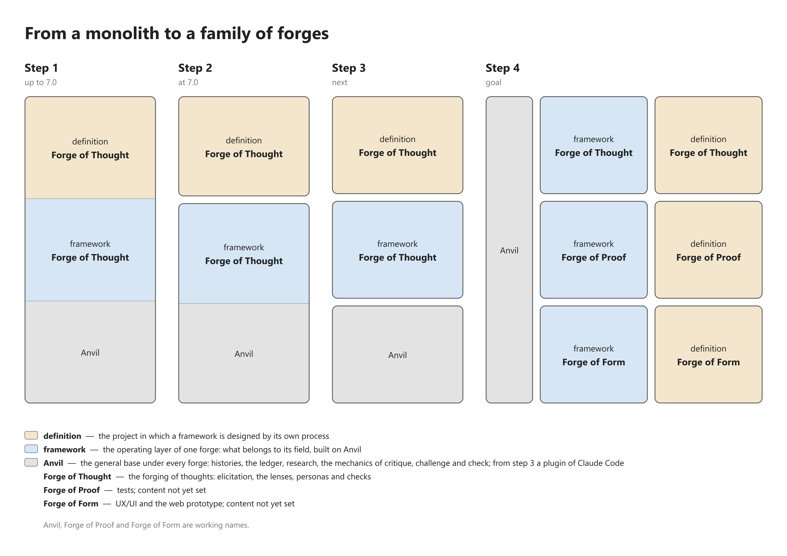

# From a monolith to a family of forges

Where the thread and the Instructions differ:

- The thread calls `framework` and `definition` names proposed by
  Claude and not decided, while the picture and its legend use them
  as plain names and the grey line marks only Anvil, Forge of Proof
  and Forge of Form as working names.
- The thread leaves open whether the working names should be shown
  in the picture at all, to be settled with the vocabulary; the
  Instructions show them and say so in the legend.
