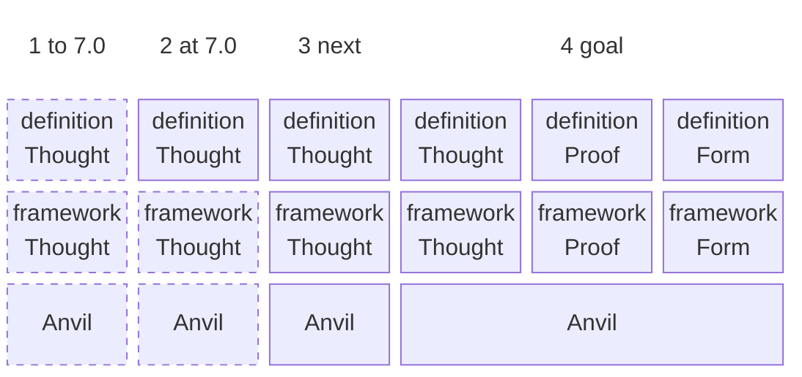

# From a monolith to a family of forges

| Term | Meaning |
|---|---|
| definition | the project in which a framework is designed by its own process |
| framework | the operating layer of one forge: what belongs to its field, built on Anvil |
| Anvil | the general base of every AI project: histories, the ledger, research, the mechanics of critique, challenge and check; from step 3 a plugin of Claude Code |
| Thought | Forge of Thought, the forging of thoughts: elicitation, the chain of artefacts, its critics, challengers and checks |
| Proof | Forge of Proof, tests: content not yet set |
| Form | Forge of Form, UX/UI and the web prototype: content not yet set |
| solid outline | a block of its own, its own repository |
| dashed outline | a layer inside one block, not yet separated |
